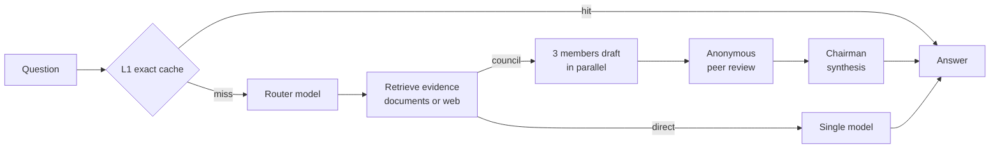

# QuorumAI

[](https://github.com/avisharma444/QuorumAI/actions/workflows/ci.yml)
[](LICENSE)

QuorumAI answers questions with a **council of LLMs**. Three models draft
answers in parallel, review one another anonymously, and a chairman model
synthesises one validated answer, grounded in your uploaded documents or the
web.

It is built as a Go control plane and a Python retrieval service, with
two-tier Redis caching, per-user authentication, full observability, and an
evaluation harness that measures what the council actually buys you.

> **Status:** works end to end, benchmarked with real models and on a rented
> GPU. Not hardened for production; see [Limitations](#limitations).

## How it works



1. **Cache and route.** An exact-match cache answers repeated questions in
   milliseconds. Otherwise a router model picks `direct`, `council` or
   `council_deep` for the question (or the client sets the strategy).
2. **Ground.** The Python service retrieves evidence from your documents
   (OCR, layout-aware chunking, BGE embeddings, ChromaDB, cross-encoder
   reranking), or searches the web when no document is attached.
3. **Deliberate.** In council mode, three members answer concurrently, then rank each other's
   anonymised answers. A member whose answer failed is not asked to review.
4. **Synthesise.** The chairman returns validated JSON. If any stage fails, the
   response falls back to the best-ranked candidate and says so (`degraded`).
   `council_deep` adds one self-audit and at most one revision.

Responses can stream every stage over SSE, and they report token usage, cache tier and
any fallback taken.

## Measured results

All numbers come from runs in this repository. Each linked document gives the
method, sample sizes and confidence intervals.

| What was measured | Result | Details |
|---|---|---|
| L1 exact cache, real models (12 questions × 3 repeats) | cold council p50 **14.3 s** → cache hit p50 **4.1 ms**; 0 model calls on all 36 hits | [real_model_performance.md](docs/real_model_performance.md) |
| Council vs single model (same evidence, n = 12, exploratory) | equal accuracy; the direct call was about **5× faster and 6× cheaper** | [real_model_performance.md](docs/real_model_performance.md) |
| Self-hosted Phi-4-mini on one RTX 4090 (vLLM, RunPod Serverless) | 256-token answer p50 **3.0 s**; **110 tok/s** per request; **532 tok/s** total at 8 concurrent requests (6.6× one request) | [gpu_inference_performance.md](docs/gpu_inference_performance.md) |
| Council with Phi-4-mini on the GPU as member 3 (n = 6) | p50 **12.7 s**, 6/6 correct; with the GPU member broken, the two hosted members still answered correctly (n = 1) | [gpu_inference_performance.md](docs/gpu_inference_performance.md) |
| Cross-encoder reranking (n = 242) | Recall@1 **0.760 → 0.851**, but multi-hop all-evidence@3 **0.782 → 0.655** | [evaluation.md](docs/evaluation.md) |
| Semantic (L2) cache safety, held-out pairs | **65% false-positive rate** at threshold 0.85, so L2 answer reuse is **off by default** | [evaluation.md](docs/evaluation.md) |
| Load test, mock models (k6, 20 virtual users) | L1-hit p95 **≈12 ms**, 0% application failures (mock latencies are not model latencies) | [performance.md](docs/performance.md) |
| Provider spend for the real-model runs | cache benchmark **$0.017**; GPU campaign **$0.201** RunPod + **$0.007** hosted models; every run under a hard spend cap | [real_model_performance.md](docs/real_model_performance.md), [gpu_inference_performance.md](docs/gpu_inference_performance.md) |

## Components

| Path | What it is |
|---|---|
| [`go-backend/`](go-backend) | Go 1.23 API and council orchestrator: auth (PostgreSQL + JWT), rate limiting, L1/L2 Redis caches behind a circuit breaker, SSE streaming, Prometheus metrics, OpenTelemetry tracing |
| [`python-rag/`](python-rag) | FastAPI retrieval service: PDF/image extraction with OCR, layout-aware chunking, BGE embeddings, ChromaDB, cross-encoder reranking, web search |
| [`ui/`](ui) | Streamlit client: accounts, conversations, document upload, per-stage inspection |
| [`evaluation/`](evaluation) | Reproducible evaluation harness: 500-question dataset, cache-safety pairs, retrieval, real-model and GPU benchmarks with budget guards |
| [`deploy/runpod/`](deploy/runpod) | Scripts to deploy, check and remove a vLLM endpoint on RunPod Serverless; each paid step needs an explicit flag |
| [`monitoring/`](monitoring) | Prometheus config and a generated, provisioned Grafana dashboard |
| [`tests/`](tests), [`benchmarks/`](benchmarks) | End-to-end smoke test, k6 load-test profiles, HTTP and cache benchmarks |
| [`config.yaml`](config.yaml) | Model choice per role: three council slots, chairman, router, ingestion |

## Quick start

Requirements: Docker with Compose. No GPU and no API keys are needed: by
default `MOCK_LLM=true` serves clearly labelled mock answers.

```bash
git clone https://github.com/avisharma444/QuorumAI.git && cd QuorumAI
cp .env.example .env
echo "JWT_SECRET=$(openssl rand -base64 48 | tr -d '\n')" >> .env
echo "POSTGRES_PASSWORD=$(openssl rand -hex 24)" >> .env
docker compose up --build
```

- UI: <http://localhost:8501> (create an account on the first screen)
- API health: <http://localhost:8080/health>

PostgreSQL, Redis and the retrieval service have no host ports. They are
reachable only on the Docker network, so nothing can bypass the Go backend's
access checks.

Try the API:

```bash
TOKEN=$(curl -sS -X POST http://localhost:8080/api/v1/register \
  -H 'Content-Type: application/json' \
  -d '{"username":"alice","password":"choose a password"}' | python3 -c 'import sys,json;print(json.load(sys.stdin)["token"])')

curl -N -X POST http://localhost:8080/api/v1/query -H "Authorization: Bearer $TOKEN" \
  -H 'Content-Type: application/json' -H 'Accept: text/event-stream' \
  -d '{"question":"Compare Go and Python concurrency","strategy":"council"}'
```

Document upload, conversations and the other endpoints are covered in
[docs/development.md](docs/development.md#smoke-test-register-upload-document-query-repeat).

## Using real models

Choose models per role in [`config.yaml`](config.yaml) (providers `gemini`,
`openrouter`, `nvidia-nim`, or `local` for a vLLM server), then set keys in
`.env`:

```dotenv
MOCK_LLM=false
OPENROUTER_API_KEY=...   # and/or GEMINI_API_KEY, NVIDIA_NIM_API_KEY
```

Keys are read only from the environment. Startup validates the whole
configuration and fails with a list of every problem; it never falls back to
mock answers silently. A council request makes at least 7 model calls, so check
provider pricing first. To run an open-weight member on your own GPU or on
RunPod, see [runpod_vllm_deployment.md](docs/runpod_vllm_deployment.md).

## Documentation

| Document | Contents |
|---|---|
| [architecture.md](docs/architecture.md) | Components, authentication and ownership, routing, chairman and self-review, providers, caching rules and thresholds |
| [observability.md](docs/observability.md) | Metrics, tracing, Grafana, k6 load-test profiles |
| [development.md](docs/development.md) | Running without Docker, API walkthrough, every test and benchmark command |
| [evaluation.md](docs/evaluation.md) · [evaluation/README.md](evaluation/README.md) | Evaluation results; harness guide |
| [real_model_performance.md](docs/real_model_performance.md) | Real-model cache and council benchmark |
| [gpu_inference_performance.md](docs/gpu_inference_performance.md) | Self-hosted Phi-4-mini on an RTX 4090: cold start, TTFT, throughput, batching, cost |
| [runpod_vllm_deployment.md](docs/runpod_vllm_deployment.md) | GPU deployment runbook and budget guards |
| [performance.md](docs/performance.md) | Load tests with mock models |
| [build_plan.md](docs/build_plan.md) · [real_model_benchmark_plan.md](docs/real_model_benchmark_plan.md) | Original phase plan and benchmark plan |

## Testing

CI runs on every push: Go race tests against real PostgreSQL and Redis Stack,
the Python retrieval suite with real OCR and models, the evaluation harness
tests, and repository checks (Compose config, dashboard generation). No test
calls a paid model API: model calls go to mocks and fakes. Run the same suites locally with
Docker, using the commands in
[docs/development.md](docs/development.md#tests-and-benchmarks).

## Limitations

- **Quality evidence is small.** On 12 easy, document-grounded questions the
  council matched a single model at about 5× the latency and 6× the cost. A
  larger, harder set is needed before claiming any quality gain.
- **L2 semantic answer reuse is unsafe** with these embeddings (near-misses
  such as "enable / disable 2FA" score as paraphrases), so it is off by default.
- **Reranking** helps single-hop questions but hurts multi-hop evidence
  coverage at k = 3.
- **GPU numbers** come from one GPU type and one run per concurrency level.
  A cold start on RunPod took 3–4 minutes.
- **Not production-ready:** no alerting rules, log aggregation, Python service
  metrics, provider retries or per-user spend budgets. No roles, document
  sharing or deletion API, token revocation or password reset.
- **Legacy documents** uploaded before authentication existed have no owner,
  so the API cannot reach them.

## Roadmap

1. **A quality study that can separate council from direct:** a larger, harder
   held-out set, alias-aware scoring, blinded review, cost and latency per
   correct answer.
2. **Safer semantic reuse:** an answer-equivalence check before L2 reuse.
3. **Multi-hop retrieval:** keep evidence diversity when reranking (e.g. MMR).
4. **Provider resilience and spend control:** bounded retries, fallback
   models, per-user token budgets.
5. **Real-model load test** under a fixed budget.
6. **Operations:** alerting rules, Python service metrics, token revocation,
   a document deletion API.

## Acknowledgements and license

QuorumAI is an independent reimplementation of
[regular-life/CouncilAI](https://github.com/regular-life/CouncilAI) (MIT, per
its README), with correctness fixes, measurements and tests. For
compatibility, internal identifiers keep the `councilai` prefix: metric names,
Redis keys, Docker volumes, the Compose project and the Go module path.

[MIT](LICENSE) © 2026 avisharma444.
